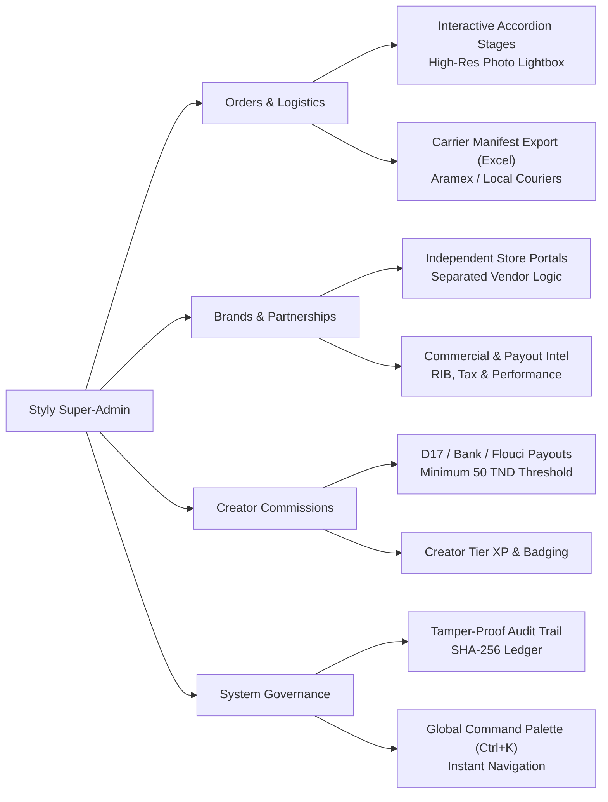
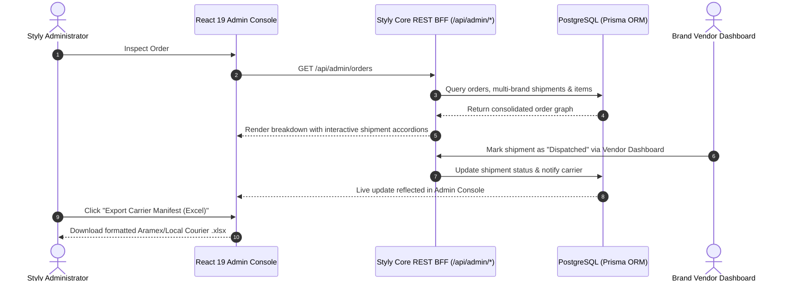

<div align="center">


# 👑 STYLY ADMIN CONSOLE
### Mission-Critical Operations, Creator Economy & Social Fashion Control Center

<p align="center">
  <strong>Tailored for the Styly Social Commerce Ecosystem in Tunisia 🇹🇳</strong><br />
  Powering Creators • Multi-Brand Marketplace Logistics • Instant Command • Tamper-Proof Audit
</p>

[](https://admin.styly.tn)
[](https://www.typescriptlang.org/)
[](https://react.dev/)
[](https://tailwindcss.com/)
[](#-bilingual-infrastructure-french--english)
[](#-security-governance--immutable-audit-trail)

</div>

---

## 📑 Table of Contents

- [✨ Executive Overview](#-executive-overview)
- [⚡ Architectural Highlights & Core Capabilities](#-architectural-highlights--core-capabilities)
  - [1. 📦 Multi-Brand Order Fulfillment & Visual Article Breakdowns](#1--multi-brand-order-fulfillment--visual-article-breakdowns)
  - [2. 🏪 Independent Brand Store Dashboards & Partner Intelligence](#2--independent-brand-store-dashboards--partner-intelligence)
  - [3. ⌨️ Global Command Palette (`Ctrl+K`) & Live Alert Hub](#3-️-global-command-palette-ctrlk--live-alert-hub)
  - [4. 🚚 Carrier Logistics & Financial Ledger Exporters](#4--carrier-logistics--financial-ledger-exporters)
  - [5. ⚖️ Customer Dispute Resolution & Mediation Center](#5-️-customer-dispute-resolution--mediation-center)
  - [6. 🛡️ Security Governance & Immutable Audit Trail](#6-️-security-governance--immutable-audit-trail)
  - [7. 🌍 Bilingual Infrastructure (French & English)](#7--bilingual-infrastructure-french--english)
- [📐 System Architecture & Data Flow](#-system-architecture--data-flow)
- [💻 Tech Stack & Engineering Standards](#-tech-stack--engineering-standards)
- [🚀 Quick Start & Development Guide](#-quick-start--development-guide)
- [👥 Ownership & Engineering Leadership](#-ownership--engineering-leadership)

---

## 🌟 Executive Overview

The **Styly Admin Console** is a high-performance, enterprise-grade operations platform crafted to manage the entire **Styly Fashion Ecosystem**. Designed specifically for the fast-paced Tunisian social commerce marketplace, it bridges the gap between:
- **Independent Partner Brands** (who operate their own distinct vendor portals for inventory management).
- **Fashion Creators & Influencers** (earning commissions by tagging authenticated outfits).
- **Shoppers & Orders** (routing deliveries across local Tunisian courier services like Aramex).
- **Platform Executives** (**Amine** & Super-Admins) with complete oversight, fraud protection, and instant command.

---

## ⚡ Architectural Highlights & Core Capabilities



### 1. 📦 Multi-Brand Order Fulfillment & Visual Article Breakdowns
- **Interactive Fulfillment Stages**: Orders containing products from multiple brand partners are split into modular shipment cards (`Lilas Boutique`, `Zara Partner`, `ElStyle Co.`).
- **Collapsible Article Drawers**: Clicking on any fulfillment stage smoothly unveils every garment in that package with:
  - High-resolution product photography with hover zoom effects.
  - Garment size, color variant, quantity, unit price in TND, and subtotal.
  - One-click **High-Res Photo Lightbox Modal** for inspection.
- **Tunisian Delivery States**: `Pending` ➔ `Brand Preparing` ➔ `Brand Confirmed` ➔ `Styly Dispatching` ➔ `User Received` ➔ `Refunded / Returned`.
- **Built-in Test Mode**: One-click `🧪 Tester Commandes & Livraisons` button injects realistic Tunisian test orders across Tunis, Sfax, Sousse, and Hammamet for zero-friction quality assurance.

### 2. 🏪 Independent Brand Store Dashboards & Partner Intelligence
- **Architectural Separation**: Each partner brand operates its **own private vendor dashboard** to manage catalog variations, inventory levels, and dispatch notifications.
- **Super-Admin Brand Oversight**:
  - Detailed Partner Modal detailing commercial contacts, legal IDs, direct phone lines, and web stores.
  - Real-time marketplace performance metrics: **On-time fulfillment rate**, total marketplace dispatches, and accumulated bank disbursements.
  - Store application approvals and instant marketplace suspension toggles.

### 3. ⌨️ Global Command Palette (`Ctrl+K`) & Live Alert Hub
- **Universal Quick Navigation**: Press `Ctrl+K` (or `Cmd+K` on macOS) to instantly search users, orders, brands, or trigger platform toggles (Test Mode, language switcher, CSV exports).
- **Real-Time Notification Hub**: Floating bell counter alerting administrators to pending withdrawals, incoming high-value orders, and flagged posts.

### 4. 🚚 Carrier Logistics & Financial Ledger Exporters
- **Tunisian Carrier Delivery Manifest (Excel)**: One-click export (`.xlsx`) pre-formatted for Tunisian couriers (Aramex, Express Delivery) containing customer phones, city destinations, addresses, and Cash on Delivery (COD) amounts.
- **Financial & Tax Ledger (PDF)**: Automated client-side PDF generator calculating Gross Merchandise Volume (GMV), customer refunds, brand store disbursements, creator commissions, and net retained platform profit.

### 5. ⚖️ Customer Dispute Resolution & Mediation Center
- **Dedicated Mediation Modal**: Full administrative resolution flow for damaged goods, wrong sizes, or courier delays.
- **Mediation Outcomes**:
  - **Full Refund** (Balance returned to customer / D17).
  - **Return & Exchange** (Generates prepaid courier return slip).
  - **Store Credit Voucher** (Customer wallet credited instantly).
  - **Claim Dismissal** with documented administrative justification.

### 6. 🛡️ Security Governance & Immutable Audit Trail
- **Tamper-Proof Audit Trail**: Cryptographically backed audit logs stored under **Settings ➔ Advanced Audit**, tracking user role changes, financial approvals, post deletions, and status updates with timestamps and IP addresses.
- **Granular RBAC Permissions**: `dashboard`, `users`, `products`, `orders`, `analytics`, `brands`, `settings`. Non-privileged staff see clean access-denied warnings.

### 7. 🌍 Bilingual Infrastructure (French & English)
- Fully wired multi-language switch covering:
  - Metric cards, table headers, filter badges, and modals.
  - Delivery fulfillment labels and carrier tracking stages.
  - Financial charts, ledger PDF exports, and toast alerts.

---

## 📐 System Architecture & Data Flow



---

## 💻 Tech Stack & Engineering Standards

| Layer | Technologies |
| :--- | :--- |
| **Framework & Core** | **React 19**, TypeScript 5.x, **Vite 7** (instant HMR, strict ESM) |
| **Styling & Design System** | **Tailwind CSS v4**, Radix UI primitives, Lucide Icons, Glassmorphism aesthetics |
| **Data Fetching & State** | **TanStack React Query**, TRPC/REST BFF compatibility layer |
| **Visualizations & Charts** | **Recharts** (Area, Bar, Composed, and Donut charts) |
| **Document Generation** | **ExcelJS** (Tunisian shipping sheets), **jsPDF + html2canvas** (Financial statements) |
| **Notifications & Modals** | **Sonner** toast suite, Radix Dialog / Alert Dialog primitives |

---

## 🚀 Quick Start & Development Guide

### Prerequisites
- **Node.js** >= 20.x
- **pnpm** >= 9.x (recommended package manager)

### Installation

```bash
# 1. Clone the repository
git clone https://github.com/7amouch2k01-oss/admin-pannel-new-ver.git
cd admin-pannel-new-ver

# 2. Install dependencies
pnpm install

# 3. Configure environment variables
cp .env.example .env

# 4. Start the development server
pnpm dev
```

Visit [`http://localhost:3000`](http://localhost:3000) in your browser.

### Quality & Production Commands

```bash
# Run strict TypeScript verification
pnpm check

# Build optimized production bundle
pnpm build

# Preview production build locally
pnpm preview
```

---

## 👥 Ownership & Engineering Leadership

| Role | Name | Responsibilities |
| :--- | :--- | :--- |
| **Founder & Platform Owner** | **Mohamed Amine Rzeigui** | Strategic Vision, Commercial Partnerships, Platform Governance |
| **Co-Founder & Platform Owner** | **Sebai Soumaya** | Social Experience, Creator Relations, Brand Operations |
| **Engineering Core** | **Styly Core Engineering** | Full-Stack Architecture, High-Velocity Logistics, Cloud Infrastructure |

<div align="center">
  <br />
  <sub>Built with passion for the next generation of Tunisian social fashion. © 2026 Styly Inc. All rights reserved.</sub>
</div>
