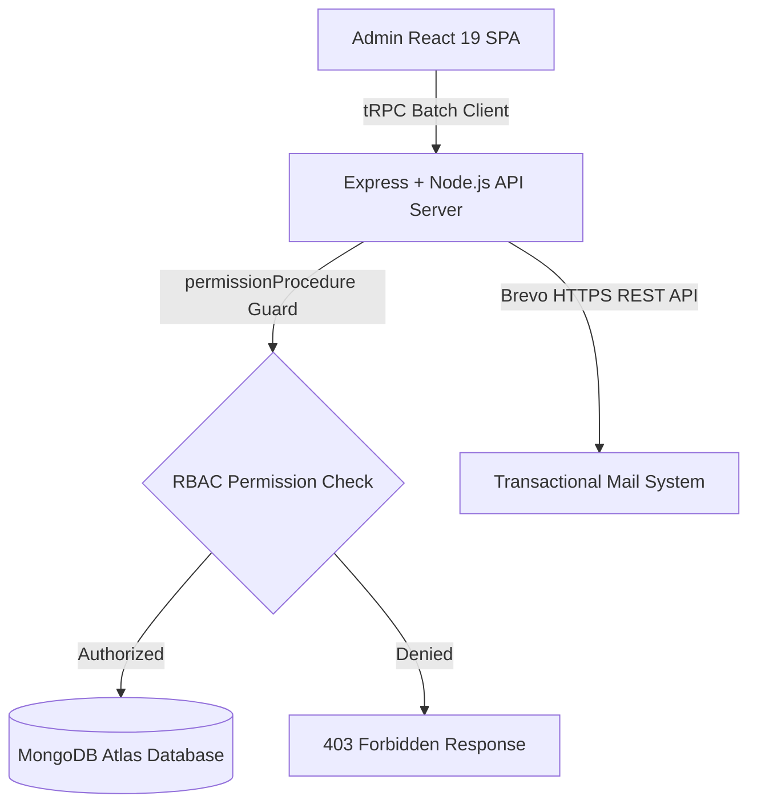

<div align="center">

# 🛡️ Styly Admin Panel — Enterprise Management & Social Commerce Operations Console

**Executive Management, Modular Role-Based Access Control, Financial Analytics, Brand Operations & Order Logistics for Styly.**

[](https://styly-admin-pannel-production.up.railway.app/)
[](https://www.typescriptlang.org/)
[](https://react.dev/)
[](https://nodejs.org/)
[](https://www.mongodb.com/)
[](https://tailwindcss.com/)

</div>

---

## 📖 Table of Contents

- [Overview](#-overview)
- [Key Features & Capabilities](#-key-features--capabilities)
  - [1. Hierarchical Role-Based Access Control (RBAC)](#1-hierarchical-role-based-access-control-rbac)
  - [2. Developer Badging & Engineering Titles](#2-developer-badging--engineering-titles)
  - [3. Creator Commission & Withdrawal Hub](#3-creator-commission--withdrawal-hub)
  - [4. Order Lifecycle, Cancellations & Refund Management](#4-order-lifecycle-cancellations--refund-management)
  - [5. Financial Accounting & Net Revenue Analytics](#5-financial-accounting--net-revenue-analytics)
  - [6. Brand Operations & Store Approvals](#6-brand-operations--brand-approvals)
- [Architecture & Tech Stack](#-architecture--tech-stack)
- [Modular Permissions Guide](#-modular-permissions-guide)
- [Environment Setup & Installation](#-environment-setup--installation)
- [API & Service Layer](#-api--service-layer)
- [Security & Auditing](#-security--auditing)

---

## 🌟 Overview

The **Styly Admin Console** is a specialized enterprise dashboard engineered to govern the **Styly Social Commerce Ecosystem**. It provides platform owners, co-owners, system administrators, and core engineers with centralized control over user accounts, brand operations, multi-vendor order routing, commission payouts, and live analytics.

---

## ✨ Key Features & Capabilities

### 1. Hierarchical Role-Based Access Control (RBAC)
* 👑 **Platform Owners** (Sebai Soumaya & Mohamed Amine Rzeigui): Full platform ownership with unconstrained rights to edit administrator permissions, assign developer roles, manage team ranks, and configure financial payout parameters.
* 🛡️ **Co-Owner**: Second-highest authority with delegated permission governance capabilities.
* 🎖️ **Styly Admin Staff**: Specialized admin accounts governed by **Granular Modular Permissions** (`dashboard`, `users`, `products`, `orders`, `analytics`, `brands`, `settings`).
* 🔒 **Owner-Only Security Protection**: Demoting, promoting, or modifying admin accounts is guarded both on the backend (`routers.ts`) and frontend UI with lock indicators for non-privileged staff.

### 2. Developer Badging & Engineering Titles
* 💻 **Interactive Developer Badge Management**: Platform Owners can grant or revoke developer status for any user or administrator.
* 🏷️ **Custom Engineering Specialization Titles**: Assign custom titles like *Lead Fullstack Engineer*, *Core Developer*, *Mobile Engineer*, or *DevOps Lead*.
* 💠 **Visual Recognition**: Displays a glowing cyan `[</> DEVELOPER TITLE]` badge throughout the team management console and user detail inspect modals.

### 3. Creator Commission & Withdrawal Hub
* 💰 **Creator Payout Processing**: Review creator withdrawal requests submitted once creators exceed the **50 TND** minimum withdrawal threshold.
* 💳 **Multi-Channel Payouts**: Support for Bank Transfers (RIB/IBAN), D17, and Flouci wallet payouts.
* 🔄 **One-Click Approval & Refund Routing**: Approve payouts to mark them completed or reject with custom administrative reasoning that automatically refunds the creator's platform balance.

### 4. Order Lifecycle, Cancellations & Refund Management
* 📦 **Multi-Brand Split Logistics**: Real-time status tracking for orders partitioned across multiple independent fashion brand partners.
* ⏱️ **3-Hour Self-Cancellation Policy**: Consumers can self-cancel orders within 3 hours of placement; after 3 hours, cancellations are locked until delivery.
* 💸 **Post-Delivery Refund Workflow**: Customers can request refunds once their items are delivered. Administrators can approve or decline refund requests, which instantly syncs with financial revenue logs.

### 5. Financial Accounting & Net Revenue Analytics
* 📊 **Tri-Metric Financial Trend Visualizer**: Real-time charts detailing:
  1. **Gross Order Volume (Red Line)**: Total customer spend.
  2. **Processed Refunds (Purple Dashed Line)**: Total returned merchandise.
  3. **Retained Net Revenue (Green Line)**: Net platform income after refunds and commission deductions.
* 📈 **Brand & Product Performance Rankings**: Track top performing designer items, creator conversion attribution, and regional order distributions.

### 6. Brand Operations & Brand Approvals
* 🏬 **Storefront Moderation**: Review incoming brand applications, inspect boutique portfolios, and verify commercial tax/legal IDs.
* 🛍️ **Catalogue Management**: Audit published looks, garments, price tags, and inventory allocations.

---

## 🛠️ Architecture & Tech Stack



* **Frontend**: React 19, TypeScript, Vite, Tailwind CSS v4, Radix UI / Shadcn, Lucide Icons, Recharts, Sonner.
* **Backend**: Node.js, Express, tRPC v11, SuperJSON, Zod, BcryptJS.
* **Database**: MongoDB Atlas with Mongoose ODM schemas.
* **Transactional Email**: Brevo v3 HTTPS REST API (Port 443 compatible).
* **Hosting**: Railway Cloud Platform with automatic CI/CD deployment.

---

## 📂 Project Directory Structure

```
styly-admin-pannel/
│
├── 📂 client/              # React 19 Single Page Applications (User App & Admin Panel)
│   ├── src/
│   │   ├── pages/          # Admin Views: Overview, Users, Posts, Orders, Analytics, Brands, Settings
│   │   ├── components/     # Modals, Dialogs, Tables, Role Badges, Developer Badges
│   │   ├── AdminApp.tsx    # Admin routing (/admin/*, /admin/reset-password, /auth)
│   │   └── App.tsx         # Consumer routing
│   ├── admin.html          # Admin Console HTML Entry
│   └── index.html          # Consumer App HTML Entry
│
├── 📂 server/              # Backend Node.js & Express API
│   ├── _core/              # Server initialization, tRPC context, modular permission middleware
│   ├── db.ts               # Core database functions & user updates
│   ├── email.ts            # Brevo HTTPS transactional email provider
│   ├── mongodb.ts          # Mongoose document schemas & models
│   └── routers.ts          # tRPC procedures with RBAC & modular permission gates
│
└── 📂 shared/              # Shared TypeScript contracts, constants & error codes
```

---

## 🚀 Getting Started

### Prerequisites
* **Node.js**: v18.0.0 or higher
* **pnpm**: v9.0.0 or higher
* **MongoDB**: Atlas connection URI

### Installation & Local Setup

1. **Clone the repository**:
   ```bash
   git clone https://github.com/7amouch2k01-oss/styly-panel.git
   cd styly-panel
   ```

2. **Install dependencies**:
   ```bash
   pnpm install
   ```

3. **Configure Environment Variables**:
   Create a `.env` file in the root directory:
   ```env
   NODE_ENV=development
   PORT=3000
   MONGODB_URI=mongodb+srv://<username>:<password>@<cluster>.mongodb.net/styly?retryWrites=true&w=majority
   BREVO_API_KEY=xkeysib-your-brevo-api-key
   SESSION_SECRET=your-secure-random-session-secret
   ```

4. **Start the Development Server**:
   ```bash
   pnpm dev
   ```
   * Consumer App: `http://localhost:3000/`
   * Admin Portal: `http://localhost:3000/admin`

5. **Type Check**:
   ```bash
   pnpm check
   ```

6. **Build for Production**:
   ```bash
   pnpm build
   ```

---

## 🔒 Security & Best Practices

* **Role-Based Procedure Gating**: Protected administrative procedures verify root permissions before executing mutations.
* **Encrypted Credentials**: Passwords are saved using multi-round salt hashing (Bcrypt).
* **Safe Email Dispatch**: All transactional emails (password reset, verification) communicate through authenticated REST endpoints over HTTPS Port 443 to eliminate SMTP blocking risks.
* **End-to-End Type Safety**: Input arguments are strictly validated with Zod schemas on every tRPC procedure call.

---

## 📄 License & Copyright

**Copyright © 2026 Styly Platform Inc. All rights reserved.**

This software and associated documentation files are the proprietary property of the Styly development team. Unauthorized copying, distribution, modification, or commercial exploitation of this codebase without prior written permission is strictly prohibited.
