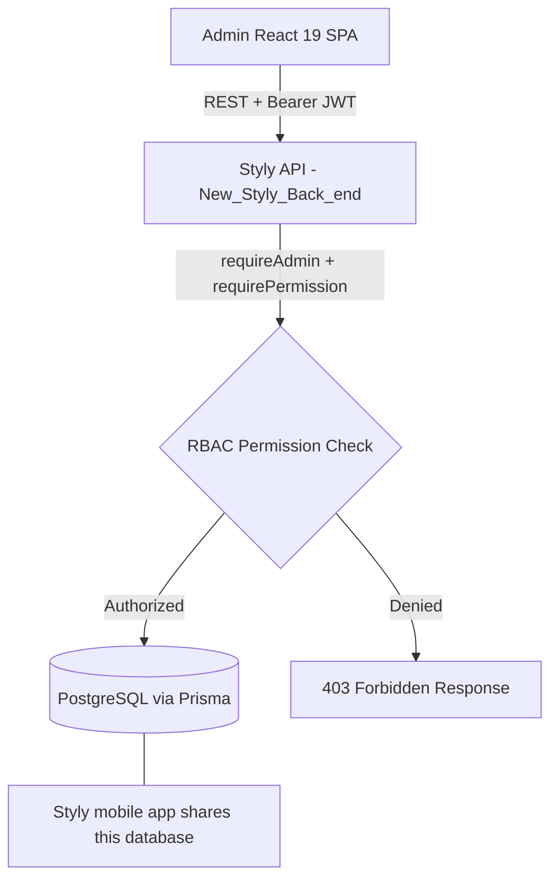

<div align="center">

# 🛡️ Styly Admin Panel — Enterprise Management & Social Commerce Operations Console

**Executive Management, Modular Role-Based Access Control, Financial Analytics, Brand Operations & Order Logistics for Styly.**

[](https://admin.styly.tn)
[](https://www.typescriptlang.org/)
[](https://react.dev/)
[](https://nodejs.org/)
[](https://www.postgresql.org/)
[](https://tailwindcss.com/)

</div>

---

## 📖 Table of Contents

- [Overview](#-overview)
- [Key Features & Capabilities](#-key-features--capabilities)
  - [1. Hierarchical Role-Based Access Control (RBAC)](#1-hierarchical-role-based-access-control-rbac)
  - [2. Developer Badging & Engineering Titles](#2-developer-badging--engineering-titles)
  - [3. Creator Commission & Withdrawal Hub](#3-creator-commission--withdrawal-hub)
  - [4. Order Lifecycle, Cancellations & Refund Management](#4-order-lifecycle-cancellations--refund-management)
  - [5. Financial Accounting & Net Revenue Analytics](#5-financial-accounting--net-revenue-analytics)
  - [6. Brand Operations & Store Approvals](#6-brand-operations--brand-approvals)
- [Architecture & Tech Stack](#-architecture--tech-stack)
- [Modular Permissions Guide](#-modular-permissions-guide)
- [Environment Setup & Installation](#-environment-setup--installation)
- [API & Service Layer](#-api--service-layer)
- [Security & Auditing](#-security--auditing)

---

## 🌟 Overview

The **Styly Admin Console** is a specialized enterprise dashboard engineered to govern the **Styly Social Commerce Ecosystem**. It provides platform owners, co-owners, system administrators, and core engineers with centralized control over user accounts, brand operations, multi-vendor order routing, commission payouts, and live analytics.

---

## ✨ Key Features & Capabilities

### 1. Hierarchical Role-Based Access Control (RBAC)
* 👑 **Platform Owners** (Sebai Soumaya & Mohamed Amine Rzeigui): Full platform ownership with unconstrained rights to edit administrator permissions, assign developer roles, manage team ranks, and configure financial payout parameters.
* 🛡️ **Co-Owner**: Second-highest authority with delegated permission governance capabilities.
* 🎖️ **Styly Admin Staff**: Specialized admin accounts governed by **Granular Modular Permissions** (`dashboard`, `users`, `products`, `orders`, `analytics`, `brands`, `settings`).
* 🔒 **Owner-Only Security Protection**: Demoting, promoting, or modifying admin accounts is guarded both on the backend (`routers.ts`) and frontend UI with lock indicators for non-privileged staff.

### 2. Developer Badging & Engineering Titles
* 💻 **Interactive Developer Badge Management**: Platform Owners can grant or revoke developer status for any user or administrator.
* 🏷️ **Custom Engineering Specialization Titles**: Assign custom titles like *Lead Fullstack Engineer*, *Core Developer*, *Mobile Engineer*, or *DevOps Lead*.
* 💠 **Visual Recognition**: Displays a glowing cyan `[</> DEVELOPER TITLE]` badge throughout the team management console and user detail inspect modals.

### 3. Creator Commission & Withdrawal Hub
* 💰 **Creator Payout Processing**: Review creator withdrawal requests submitted once creators exceed the **50 TND** minimum withdrawal threshold.
* 💳 **Multi-Channel Payouts**: Support for Bank Transfers (RIB/IBAN), D17, and Flouci wallet payouts.
* 🔄 **One-Click Approval & Refund Routing**: Approve payouts to mark them completed or reject with custom administrative reasoning that automatically refunds the creator's platform balance.

### 4. Order Lifecycle, Cancellations & Refund Management
* 📦 **Multi-Brand Split Logistics**: Real-time status tracking for orders partitioned across multiple independent fashion brand partners.
* ⏱️ **3-Hour Self-Cancellation Policy**: Consumers can self-cancel orders within 3 hours of placement; after 3 hours, cancellations are locked until delivery.
* 💸 **Post-Delivery Refund Workflow**: Customers can request refunds once their items are delivered. Administrators can approve or decline refund requests, which instantly syncs with financial revenue logs.

### 5. Financial Accounting & Net Revenue Analytics
* 📊 **Tri-Metric Financial Trend Visualizer**: Real-time charts detailing:
  1. **Gross Order Volume (Red Line)**: Total customer spend.
  2. **Processed Refunds (Purple Dashed Line)**: Total returned merchandise.
  3. **Retained Net Revenue (Green Line)**: Net platform income after refunds and commission deductions.
* 📈 **Brand & Product Performance Rankings**: Track top performing designer items, creator conversion attribution, and regional order distributions.

### 6. Brand Operations & Brand Approvals
* 🏬 **Storefront Moderation**: Review incoming brand applications, inspect boutique portfolios, and verify commercial tax/legal IDs.
* 🛍️ **Catalogue Management**: Audit published looks, garments, price tags, and inventory allocations.

---

## 🛠️ Architecture & Tech Stack



This console has **no backend of its own**. It is a static SPA that talks to the
same Styly API the mobile app uses, over `/api/admin/*` — a set of admin-only
routes guarded by `requireAdmin` plus a per-module permission check. It used to
ship a co-located tRPC + MongoDB server; that was removed and the console
rewired to the real backend, so there is now a single source of truth for users,
posts, orders, brands and commissions.

* **Frontend**: React 19, TypeScript, Vite, Tailwind CSS v4, Radix UI / Shadcn, Lucide Icons, Recharts, Sonner, TanStack Query.
* **Backend**: the Styly API (Node.js, Express, Prisma) — a separate repository.
* **Database**: PostgreSQL, shared with the Styly mobile app.
* **Auth**: JWT access token (`Authorization: Bearer`) + rotating refresh token.
* **Hosting**: static build served by nginx on the Styly VPS, same-origin with the API; deployed by GitHub Actions on push to `main` (see `.github/DEPLOYMENT.md`).

---

## 📂 Project Directory Structure

```
styly-admin-pannel/
│
├── 📂 client/              # React 19 Single Page Applications (User App & Admin Panel)
│   ├── src/
│   │   ├── pages/          # Admin Views: Overview, Users, Posts, Orders, Analytics, Brands, Settings
│   │   ├── components/     # Modals, Dialogs, Tables, Role Badges, Developer Badges
│   │   ├── AdminApp.tsx    # Admin routing (/admin/*, /admin/reset-password, /auth)
│   │   └── App.tsx         # Consumer routing
│   ├── admin.html          # Admin Console HTML Entry
│   └── index.html          # Consumer App HTML Entry
│
└── 📂 client/src/lib/api/  # Data layer — the only place that knows about HTTP
    ├── index.ts            # Call surface used by the pages (api.users.list.useQuery(), …)
    ├── core.ts             # useQuery/useMutation/useUtils primitives over TanStack Query
    ├── endpoints.ts        # One function per procedure -> REST route
    ├── http.ts             # Bearer header, envelope unwrapping, refresh-and-retry
    ├── auth-store.ts       # Token storage + cross-tab sync
    └── errors.ts           # Error normalisation (the API has several error shapes)
```

---

## 🚀 Getting Started

### Prerequisites
* **Node.js**: v20.19.0 or higher
* **pnpm**: v9.0.0 or higher
* **The Styly API**: running locally (default `http://127.0.0.1:4000`)

### Installation & Local Setup

1. **Clone the repository**:
   ```bash
   git clone https://github.com/7amouch2k01-oss/styly-panel.git
   cd styly-panel
   ```
   You will also need the Styly API running locally — the console has no backend
   of its own.

2. **Install dependencies**:
   ```bash
   pnpm install
   ```

3. **Point it at the Styly API**:
   In development, Vite proxies `/api` to `http://127.0.0.1:4000` — start the
   Styly backend first and nothing else is needed. To target a different host:
   ```env
   # .env — dev only; overrides the proxy target
   VITE_API_PROXY_TARGET=http://127.0.0.1:4000
   # production builds call the API directly, so set an absolute URL
   VITE_API_BASE_URL=https://api.your-domain.tld
   ```
   When deploying, add this console's origin to the API's `CORS_ORIGIN` list.

4. **Grant yourself access** (in the backend repository):
   ```bash
   node scripts/make-admin.js you@example.com --owner
   ```
   The account must already exist. `--owner` bypasses every module check and
   cannot be demoted or deactivated from the console.

5. **Start the Development Server**:
   ```bash
   pnpm dev
   ```
   * Admin Portal: `http://localhost:3001/admin`

6. **Type Check**:
   ```bash
   pnpm check
   ```

7. **Build for Production**:
   ```bash
   pnpm build
   ```

---

## 🔒 Security & Best Practices

* **Server-Side Authorization**: every `/api/admin/*` route is gated by `requireAdmin` plus a per-module permission check. The UI's own checks are cosmetic — the server is the authority.
* **Owner Protection**: the platform owner cannot be demoted or deactivated, so the console can never be locked out of its own permission tree.
* **Encrypted Credentials**: passwords are hashed with bcrypt (cost 12) by the API.
* **Token Handling**: short-lived access token with a rotating refresh token; refreshes are single-flight and shared across tabs so a rotation cannot revoke a sibling tab's session.
* **Audit Trail**: every admin mutation writes an `ActivityLog` row (who, what, when), surfaced in the Overview activity stream.

---

## 📄 License & Copyright

**Copyright © 2026 Styly Platform Inc. All rights reserved.**

This software and associated documentation files are the proprietary property of the Styly development team. Unauthorized copying, distribution, modification, or commercial exploitation of this codebase without prior written permission is strictly prohibited.
