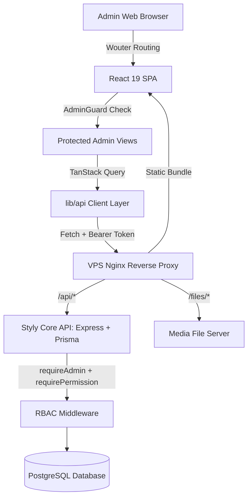

# Architecture Documentation — Styly Admin Dashboard

## 1. System Overview

The **Styly Admin Dashboard** is an enterprise operations console built as a React 19 Single Page Application (SPA). It provides authorized administrators, co-owners, and platform owners with centralized operational and financial control over the Styly social-commerce ecosystem.

The console communicates with the unified Styly Core API (`New_Styly_Back_end`), sharing a single PostgreSQL database with the mobile application.



---

## 2. Directory Structure

```
styly-admin-dashboard/
├── .github/
│   ├── DEPLOYMENT.md             # Production VPS deployment protocol
│   └── workflows/
│       └── deploy.yml            # GitHub Actions automated deployment on push to main
├── client/
│   ├── index.html                # SPA HTML template
│   ├── public/                   # Static logos and fallback icons
│   └── src/
│       ├── _core/
│       │   └── hooks/
│       │       └── useAuth.ts    # React auth state hook (wraps auth.me and auth.logout)
│       ├── components/
│       │   ├── ui/               # Radix UI and Tailwind CSS primitives
│       │   ├── AdminGuard.tsx    # Route protection with granular permission validation
│       │   ├── DashboardLayout.tsx # Admin top bar, sidebar, and tab navigation
│       │   ├── ShortId.tsx       # Click-to-copy entity ID display
│       │   ├── UserDetailDialog.tsx # User inspection and role/status edit modal
│       │   ├── UserFormDialog.tsx # Admin user creation modal
│       │   └── BrandFormDialog.tsx # Brand creation modal
│       ├── contexts/
│       │   └── ThemeContext.tsx  # Dark/light theme management
│       ├── lib/
│       │   ├── api/
│       │   │   ├── auth-store.ts # LocalStorage token persistence & BroadcastChannel sync
│       │   │   ├── core.ts       # React Query hook factory (mimics tRPC useQuery/useMutation)
│       │   │   ├── endpoints.ts  # Typed REST API service calls
│       │   │   ├── errors.ts     # Normalized ApiError parser
│       │   │   ├── http.ts       # Fetch transport with rotating token auto-refresh
│       │   │   ├── index.ts      # Main api export
│       │   │   └── types.ts      # DTO schemas and domain models
│       │   ├── media.ts          # Normalizer for /files/:uuid and remote CDN image URLs
│       │   ├── trpc.ts           # Backwards-compatibility alias export for api
│       │   └── utils.ts          # clsx + tailwind-merge helper
│       ├── pages/
│       │   ├── Overview.tsx      # Dashboard KPI summary & quick links
│       │   ├── Users.tsx         # User directory, developer badging, and withdrawal approvals
│       │   ├── Products.tsx      # Lookbook & garment post moderation
│       │   ├── Orders.tsx        # Order status tracking, cancellation, and refund management
│       │   ├── Analytics.tsx     # Financial analytics & revenue trend visualization
│       │   ├── Brands.tsx        # Brand verification and store approvals
│       │   ├── Settings.tsx      # Admin preferences and security settings
│       │   ├── Auth.tsx          # Login & registration portal
│       │   ├── ResetPassword.tsx # 2-step password reset with OTP
│       │   ├── Unauthorized.tsx  # 403 Forbidden fallback screen
│       │   └── NotFound.tsx      # 404 Not Found fallback screen
│       ├── AdminApp.tsx          # Router configuration and flat wouter route mapping
│       └── main.tsx              # React entrypoint with QueryClient setup
├── deploy/
│   └── nginx/
│       └── admin.styly.tn.conf   # Production Nginx reverse proxy configuration
├── docs/                         # Architecture, guides, and engineering decisions
├── patches/
│   └── wouter@3.7.1.patch       # Wouter regex fix for exact matching
├── package.json                  # Scripts and dependencies
├── pnpm-lock.yaml                # Exact dependency lockfile
├── tsconfig.json                 # Strict TypeScript configuration
├── vite.config.ts                # Vite build & local dev proxy configuration
└── vitest.config.ts              # Unit and integration test runner config
```

---

## 3. Authentication & Session Architecture

### Token Lifecycle

1. **Storage**: Access and refresh tokens are stored in `localStorage` under key `styly.admin.auth`.
2. **Rotating Refresh**:
   - Refresh tokens rotate upon every refresh call (`/api/auth/refresh`).
   - Single-flight synchronization (`inflightRefresh` in `lib/api/http.ts`) guarantees that concurrent requests wait for a single active refresh exchange rather than triggering racing calls.
   - Cross-tab coordination is managed via a dedicated `BroadcastChannel('styly-admin-auth')` so sibling tabs automatically adopt new credentials without invalidating the token pair.
3. **Automatic Expiry Handling**: When an access token expires (401), the transport attempts an automated background refresh. If refresh fails or the refresh token itself is expired, tokens are cleared and the user is redirected cleanly to `/auth`.

---

## 4. Role-Based Access Control (RBAC) Architecture

### Role Hierarchy

1. **Platform Owner (`isOwner === true`)**:
   - Identified server-side by database flag.
   - Complete platform control: bypasses all individual permission gates, has exclusive privilege to promote/demote administrators, grant developer badges, and assign engineering titles.
2. **Co-Owner (`isCoOwner === true`)**:
   - Delegated executive administration with permission management capabilities for regular admin staff.
3. **Styly Panel Admin (`role === "admin"`)**:
   - Access is constrained by the granular permissions array assigned to their profile.
4. **Regular User (`role === "user"`)**:
   - Strictly prohibited from accessing `/admin/*`. Redirected to `/unauthorized`.

### Granular Permissions List

- `dashboard`: Access executive metrics, KPI cards, and recent activity logs.
- `users`: View shopper profiles, creator levels, style points, and process withdrawal requests.
- `products`: Moderate creator outfit lookbooks, manage garment tags, and hide/restore posts.
- `orders`: Review multi-brand orders, manage carrier tracking, approve refunds, and cancel orders.
- `analytics`: View gross sales, returned merchandise volume, and retained net revenue ledgers.
- `brands`: Approve pending brand boutique applications and audit brand catalogs.
- `settings`: Modify administrative notification preferences and change account password.

---

## 5. Media & Asset Pipeline

The console consumes image assets generated by the mobile app, brand uploads, and external CDNs.
- Local uploads live at `/files/:uuid` on the backend.
- `lib/media.ts` automatically re-hosts `/files/:uuid` to the current origin while safely preserving absolute external CDN links (e.g., Shopify CDN or Cloudinary). This prevents host mismatch errors across development and production environments.
